[gitpad](https://github.com/lurio84/gitpad) · [waystone](https://github.com/lurio84/waystone) · [CryptoTrader](https://github.com/lurio84/CryptoTrader) · [claude-skills](https://github.com/lurio84/claude-skills) · [LinkedIn](https://www.linkedin.com/in/lucasron)

